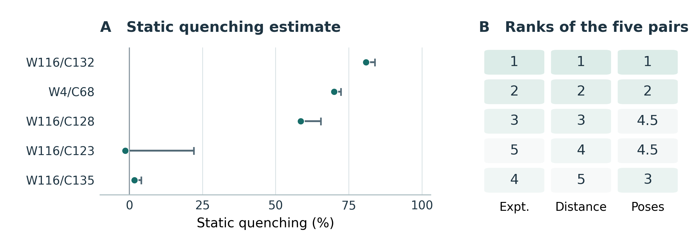

# Predicting static quenching of bimane by tryptophan

This study compares two ways to choose a fluorescent labeling site. One ranks sites by the distance between the backbone Cα atoms of a tryptophan and a bimane-labeled cysteine. The other ranks them by the fraction of modeled dye and side-chain conformations in which the two rings can touch. Five published measurements in T4 lysozyme provide the experimental comparison. A separate calculation applies the same question to the designed protein α3D.

**[Read the paper (PDF)](paper/bimane-static-quenching.pdf)** · [Editable manuscript (Word)](paper/bimane-static-quenching.docx) · [日本語版](README.ja.md)

## Findings

- **Backbone distance ranked these five pairs more closely.** Spearman’s ρ with the experimental static-quenching estimates was 0.90 for distance and 0.82 for the contact score. The model found zero contacts in 171 allowed conformations of W116/C128, a pair with an experimental estimate of 58.5%.
- **A55C is an experimental candidate in α3D.** With the native Trp4 orientation fixed, bimane could approach the indole ring in 33 of 260 allowed A55C conformations. With Trp4 sampled, the count was 90 of 556. None of the other eight eligible sites produced contacts on these grids. A44C is the next closest site by backbone distance and provides a comparison for a future measurement.
- Four of the five T4 pairs share a quencher site. The modeled fractions depend on the angular grid and steric rules. The fluorescence response, folding stability and performance of the α3D variants have yet to be measured.



Rank 1 denotes the largest measured or predicted static-quenching fraction. The plot reproduces the upper error-bar lengths shown in the source figure. [Original spectroscopy](https://doi.org/10.1021/bi500493r) · [Supplementary information](https://doi.org/10.1021/bi500493r.s001)

## Data and outputs

| File | Contents |
| --- | --- |
| [Source manifest](data/sources.json) | URLs and SHA-256 hashes for the structures, source papers and annotated inputs |
| [Static fraction annotations](data/experimental/figure4c_pixels.csv) and [intensity ratio annotations](data/experimental/figure4a_pixels.csv) | Coordinates of the axis ticks, bar edges and applicable error bars in the published figure |
| [T4 lysozyme results](results/calibration.csv) | Measured estimates, Cα distances, allowed conformations, contacts and ranks for all five pairs |
| [Rank statistics](results/rank_metrics.csv) and [leave-one-pair-out results](results/leave_one_out.csv) | Primary and secondary endpoints, tied near-zero estimates and sensitivity to individual pairs |
| [Conformation counts](results/geometry_sensitivity.csv) and [correlations by setting](results/sensitivity_ranks.csv) | Contact cutoffs, clash tolerances, grid shift and denser linker sampling |
| [α3D site screen](results/alpha3d_sites.csv) | All ten alanines considered, their solvent exposure, eligibility and results for the nine retained sites |
| [Follow-up sequences](results/alpha3d_followup.fasta) | A55C, A44C and their respective W4F controls. All four constructs are experimentally untested here |
| [Vector figure](results/figure1.pdf) | Standalone, printable version of Figure 1 |

## Reproduce the study

Run these commands from this study directory. The inputs needed for the analysis are included in the repository. Python 3.12 or later and the packages pinned in [requirements.txt](requirements.txt) are sufficient for the numerical analysis, plots and Word manuscript.

```sh
python3 -m venv .venv
.venv/bin/python -m pip install -r requirements.txt
make all PYTHON=.venv/bin/python
```

The default build verifies input hashes, calculates all results, writes Figure 1 in English, checks the outputs and rebuilds the English Word manuscript. The individual commands are also available for systems without Make.

```sh
python analysis/run.py
python analysis/figures.py
python scripts/check_results.py
python paper/build_manuscript.py
```

With LibreOffice installed, `make pdf PYTHON=.venv/bin/python` also exports the English paper as a PDF. Set `SOFFICE` to the executable path if the command has a different name on your system. The optional `japanese` and `japanese-pdf` targets rebuild the corresponding Japanese editions. Redrawing the Japanese figure uses a Japanese font such as Noto Sans CJK JP.

## Audit the experimental values

The experimental static fractions were estimated by the original authors from intensity and lifetime measurements. Here they were digitized from the tryptophan series in panel C of Figure 4. The steady-state intensity ratios came from panel A. We retained the slightly negative point estimate for W116/C123 and evaluated a separate sensitivity analysis tying the two estimates near zero. The source reports triplicate intensity ratios for the 8.4 Å pair and quadruplicate ratios for the others. The experimental unit in our ranking is the site pair. [Source article](https://pmc.ncbi.nlm.nih.gov/articles/PMC4196733/)

With Poppler’s `pdfimages` installed, either command below checks the annotations against the original image. The first downloads a temporary copy of the source PDF from the US National Library of Medicine. Both verify the source hash. The image is 1,250 × 1,289 pixels. Pixel coordinates start at the top left. In panel C, 0% is at y = 1097.5 and 100% at y = 813.0, for a readout of approximately 0.35 percentage points per pixel.

```sh
python scripts/audit_source.py
python scripts/audit_source.py --pdf /path/to/PMC4196733.1.pdf
```

## Interpreting the model

The T4 lysozyme backbone came from 1L63. Structure 2A3D supplied the α3D coordinates and template indole geometry. Structure 9PHR supplied the covalent Cys151–9UM bimane geometry (chain A, alternate location A). The analysis enumerates 54 tryptophan conformations and 1,944 dye conformations per T4 pair. The primary contact cutoff is 4.5 Å between ring heavy atoms, with a nonbonded clash tolerance of 0.30 Å. All allowed poses receive equal weight. [1L63](https://www.rcsb.org/structure/1L63) · [2A3D](https://www.rcsb.org/structure/2A3D) · [9PHR](https://www.rcsb.org/structure/9PHR)

A zero score means that at least one pose was allowed and none met the contact cutoff. A missing score means that there were no allowed poses or that the site fell outside the selection criteria. A rank correlation is undefined if all predicted scores tie. The exact permutation p values in the results refer to each ordering separately. The post hoc denser linker grid was applied to all five pairs after the primary analysis missed W116/C128. The manuscript and [geometry code](analysis/geometry.py) document the angular grids, bonded-neighbor exceptions and α3D exposure criterion.
